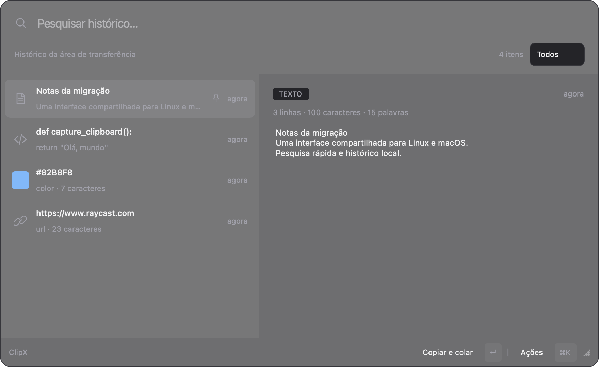
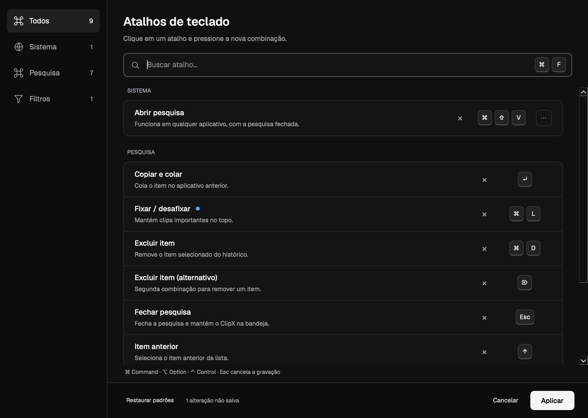

<p align="center">
  
  <br>
  <a href="LICENSE"></a>
</p>

# ClipX

Histórico local da área de transferência para **Linux e macOS**, com interface compartilhada em PyQt6 e visual escuro inspirado no Raycast. Busca, filtros, prévias e preferências usam o mesmo código; captura, cópia, colagem, atalhos e material da janela têm drivers específicos do sistema.



## Começar

Requisitos: **Python 3.14+** e **uv**. Na pasta do projeto:

```bash
uv sync --frozen
uv run --frozen clipx
```

A instalação cria `.venv` e seleciona o Python de `.python-version`. O uv pode baixar o interpretador quando necessário. A primeira instalação requer internet. Não há `.env`, chave de API ou serviço remoto obrigatório.

Se o uv estiver em `~/.local/bin` e não for encontrado:

```bash
export PATH="$HOME/.local/bin:$PATH"
```

Ativar o ambiente é opcional:

```bash
source .venv/bin/activate
clipx --help
```

O launcher `./bin/clipx` também funciona por link simbólico e fora da pasta do projeto. Usa uv quando disponível e, caso contrário, a `.venv` existente.

## Funcionalidades

- Histórico de texto, código, JSON, links e cores; pesquisa e prévia com destaque de sintaxe.
- Deduplicação por SHA-256 e SQLite local; até 500 itens não fixados, além dos fixados.
- Até 100 resultados por busca; seleção e rolagem preservadas durante atualizações.
- Janela de 880 × 540, mínimo de 720 × 460, divisor ajustável e posicionamento na tela do cursor.
- Menu **Ações** para copiar e colar, copiar apenas, fixar/desafixar e excluir.
- Bandeja/barra de menus com os cinco clips mais recentes, preferências, atalhos e estado da captura.
- Preferências de tema claro/escuro/sistema, escala, densidade, lista, prévia e comportamento da janela, aplicadas sem reinício.
- Instância única: chamar `clipx show` reabre a instância existente.
- Falha de cópia mantém a pesquisa aberta; indisponibilidade e permissões aparecem na interface.

O histórico desta versão é **exclusivamente textual**. Imagens, arquivos, texto rico e sincronização não estão incluídos.

## macOS

Compatibilidade-alvo: **macOS 14+**, com validação nativa inicial em **macOS 27 ARM64**. As versões anteriores e Macs Intel ainda precisam de validação em hardware correspondente.

```bash
uv sync --frozen
uv run clipx        # Pesquisa + captura + barra de menus
uv run clipx tray   # Inicia com a pesquisa escondida
```

O atalho global padrão é **⌘⇧V**. Ele é registrado apenas enquanto o aplicativo está rodando e pode ser alterado em **Atalhos** na barra de menus. O registro usa Carbon/HIToolbox, sem monitoramento global de todas as teclas. Se a combinação não puder ser registrada, a anterior é preservada; o ClipX não transfere atalhos do macOS.

A captura consulta `NSPasteboard.changeCount` a cada aproximadamente **250 ms**, lendo texto somente quando o contador muda. Funciona com a janela escondida. Alterações intermediárias sobrescritas entre verificações podem não ser capturadas. Conteúdo marcado como confidencial, transitório ou gerado automaticamente é ignorado, assim como as escritas do próprio ClipX. Esses marcadores dependem do aplicativo de origem: não representam uma garantia de detecção de todo conteúdo sensível.

### Colagem e permissões

Selecionar um item copia o texto e tenta colar no aplicativo que estava ativo antes da pesquisa. O ClipX confirma o foco no destino antes de enviar **⌘V** e desiste após 1 segundo se não conseguir ativá-lo.

A colagem automática requer a autorização de Acessibilidade/controle do macOS. Sem ela, o texto continua copiado e pode ser colado manualmente. Use **Autorizar colagem no macOS** na barra de menus para abrir a solicitação nativa; o aplicativo não repete solicitações automaticamente. Restrições de leitura do clipboard também são respeitadas e aparecem como estado de captura.

Ao executar por uv, a autorização pode ficar associada ao interpretador Python ou ao aplicativo lançador, e pode precisar ser revista quando o interpretador mudar. O empacotamento gera bundle `.app` e DMG; assinatura Developer ID e notarização dependem dos secrets Apple descritos em [Builds e releases](packaging/README.md). Inicialização automática no login não está incluída.

### Material da janela

Quando disponível, usa **NSGlassEffectView** atrás dos controles Qt. Em sistemas anteriores, usa **NSVisualEffectView** com material de popover escuro. Redução de transparência ou falha da integração ativa o fundo opaco. Redução de movimento desativa a transição de abertura. Mudanças nas preferências de acessibilidade atualizam o material.

## Linux / GNOME

A captura preserva o fluxo X11/XWayland por eventos XFixes, com requestor invisível e sem disputa de foco. Quando `DISPLAY` não está definido, usa `wl-paste --watch`, que depende do suporte do compositor a data-control. Na ausência desse suporte, a captura fica indisponível, sem abrir janelas de fallback.

No Ubuntu/Debian:

```bash
sudo apt update
sudo apt install wl-clipboard xclip
uv sync --frozen
uv run clipx
```

`wtype` ou `ydotool` são opcionais para colagem automática; dependem do compositor e de suas permissões. A bandeja do GNOME precisa de suporte a AppIndicator/KStatusNotifierItem, como Ubuntu AppIndicators.

O material visual Linux é desenhado pelo Qt: grafite predominantemente opaco, bordas sutis e camadas. Não requer extensões para blur e não promete desfoque real do desktop.

### Atalho e serviço GNOME

Execute na sessão gráfica Linux/GNOME do usuário:

```bash
./install_shortcut.sh
```

O instalador verifica Linux, uv, gsettings e a sessão systemd do usuário antes de modificar a instalação. Cria o link `~/.local/bin/clipx`, a entrada `clipx.desktop`, o serviço `clipx-daemon.service` em modo bandeja e o atalho inicial **Super + V**. Reinstalações preservam a combinação escolhida.

Mantenha a pasta do projeto no mesmo lugar: o serviço e o launcher apontam para ela. O serviço usa `Restart=on-failure`; sair por **Quit** não causa reinício automático.

```bash
systemctl --user status clipx-daemon.service
systemctl --user start clipx-daemon.service
systemctl --user stop clipx-daemon.service
journalctl --user -u clipx-daemon.service -f
```

O driver GNOME preserva a verificação de conflitos, a transferência confirmada de combinações e a recuperação de atalhos pausados durante gravação.

## Comandos e atalhos

```bash
uv run clipx              # Pesquisa, bandeja e captura
uv run clipx gui           # Mesmo comportamento
uv run clipx show          # Abre/reabre a pesquisa
uv run clipx tray          # Inicia com a pesquisa fechada
uv run clipx daemon        # Captura separada, sem interface
uv run clipx add "texto"   # Adiciona ao histórico, sem alterar o clipboard
uv run clipx clear         # Remove itens não fixados
uv run clipx clear --all   # Remove todos, inclusive fixados
```

Não execute o daemon separado junto da bandeja: a bandeja já inicia sua captura. **Esc** fecha a pesquisa; **Quit** encerra o aplicativo, worker, atalho macOS e material nativo.

| Ação | Linux | macOS |
| --- | --- | --- |
| Abrir pesquisa | Super + V, após instalação GNOME | ⌘⇧V, enquanto ClipX está ativo |
| Copiar e tentar colar | Enter | Enter |
| Navegar | ↑ / ↓ | ↑ / ↓ |
| Alternar filtros | Tab | Tab |
| Fixar/desafixar | Ctrl + P | ⌘P |
| Excluir | Ctrl + D ou Delete | ⌘D ou Delete |
| Abrir ações | Ctrl + K | ⌘K |
| Fechar pesquisa | Esc | Esc |

Os atalhos da pesquisa são configuráveis e escolhas existentes são preservadas. O formato portátil do Qt chama a tecla Command de `Ctrl` e a tecla Control de `Meta` no macOS; a interface exibe os símbolos nativos. Combinações personalizadas existentes têm precedência sobre a abertura do menu Ações por Ctrl/Command + K.

## Dados e migração

| Dado | Linux | macOS |
| --- | --- | --- |
| Histórico | `~/.local/share/clipx/history.db` | `~/Library/Application Support/ClipX/history.db` |
| Preferências | `~/.config/clipx/settings.json` | `~/Library/Preferences/ClipX/settings.json` |
| Runtime | `$XDG_RUNTIME_DIR` ou `/tmp/clipx-runtime-UID` | `/tmp/clipx-runtime-UID` |

Linux respeita `XDG_DATA_HOME` e `XDG_CONFIG_HOME`. No macOS, se o destino não existir, a inicialização copia dados dos antigos caminhos XDG, usando a API de backup SQLite para incluir transações no WAL. Mantém a origem e uma cópia `*.pre-migration.bak` no destino. Arquivos já migrados não são sobrescritos. O esquema do histórico permanece compatível.

O conteúdo fica em texto legível no banco local, sem criptografia implementada pelo aplicativo. O diretório de runtime é privado do usuário e usa caminho curto para os sockets locais do macOS.

## Arquitetura e desenvolvimento

```text
clipx/
  main.py             CLI, seleção da plataforma e ciclo de vida
  capture.py          Ingestão comum, classificação e entrada dos workers
  daemon.py           Supervisor do processo de captura e sinais de estado
  services.py         Serviço de cópia compartilhado por pesquisa e bandeja
  storage.py          SQLite e deduplicação
  detector.py         Classificação de texto, código, URL e cor
  shortcuts.py        Preferências e sequências Qt portáteis
  instance.py         Instância única e comunicação local
  platforms/
    base.py           Contratos e resultados explícitos
    paths.py          Caminhos e migração não destrutiva
    linux/            XFixes, ferramentas Wayland/X11, GNOME e ativação
    macos/            NSPasteboard, AppKit, Quartz, Carbon e material nativo
  ui/
    foundations/      Tokens, estilos e ícones
    atoms/            Elementos básicos (teclas e feedback)
    molecules/        Busca, linhas, gravação e sequências de teclas
    organisms/        Sidebar, seções, rodapés, lista, prévia e menu
    templates/        Layouts de preferências e pesquisa
    pages/            Janelas e diálogos completos
    controllers/      Gravação/aplicação e controle da bandeja
    models/           Catálogo e metadados de apresentação
bin/clipx             Launcher
install_shortcut.sh   Instalação exclusiva do Linux/GNOME
```

O fluxo é **driver → captura compartilhada → detector/SQLite → UI**. O supervisor encerra o worker ao sair. Workers não acessam widgets; estados chegam à UI por sinais Qt enfileirados. Dependências AppKit/Quartz são carregadas apenas no macOS, e python-xlib só é instalado no Linux.

### Tela de atalhos e Atomic Design

A tela de atalhos segue a referência escura com navegação lateral, busca por nome/combinação, grupos, teclas individuais e alterações não salvas. **Cancelar** descarta o rascunho; **Aplicar** salva depois das verificações existentes. O botão **⋯** permite escolher uma combinação sem pressioná-la. **⌘F / Ctrl+F** foca a busca.



A organização da interface, as regras de dependência e os comandos para gerar prévias estão em [ui/README.md](clipx/ui/README.md). Os imports internos de interface mudaram; CLI, dados e preferências permanecem compatíveis.

A pesquisa não tem barra de título nem controles de janela, seguindo o estilo de launcher. Preferências e diálogos usam a moldura e os controles nativos do sistema: no macOS, os botões característicos do sistema, com barra de título integrada ao grafite do ClipX e aparência escura. A integração altera a cor da barra sem substituir os botões AppKit. No Linux, a decoração continua sob controle do gerenciador de janelas. Fechar a pesquisa mantém captura e bandeja funcionando. A pesquisa também se esconde ao perder o foco, preservando seus menus e diálogos. O painel grafite é predominantemente opaco sobre o material nativo, sem animação de opacidade da janela inteira.

As barras de rolagem usam o estilo de plataforma do Qt, sem dimensões ou desenho impostos pelo tema ClipX. No macOS isso permite o comportamento de rolagem nativo conforme as preferências do sistema.

A tipografia usa **Geist** e **Geist Mono**, incluídas no pacote e carregadas localmente, sem instalação no sistema ou download durante a execução. A origem e a licença SIL Open Font License estão em [assets/fonts/SOURCE.md](clipx/assets/fonts/SOURCE.md).

Validação em 21/10/2026: **89 testes na suíte comum, com 80 aprovados e 9 ignorados**; os **7 testes nativos macOS** passaram separadamente. A interface foi renderizada em macOS nas dimensões normal e mínima e nos estados de busca, vazio e gravação. Perda de foco e preservação dos menus têm testes automatizados; o clique físico em outro aplicativo ainda requer conferência manual.

Para carregar alterações no código, encerre a instância anterior em **Quit** na bandeja e execute na raiz do projeto:

```bash
uv sync --frozen
uv run clipx
```

Para iniciar apenas na bandeja, use `uv run clipx tray`.

### Documentação no código

Todo módulo, classe, função e método do projeto usa docstrings no padrão
[Google Python Style Guide](https://google.github.io/styleguide/pyguide.html#38-comments-and-docstrings),
em inglês, com as seções `Args:`, `Returns:`, `Yields:`, `Raises:` e `Attributes:`
quando aplicáveis. As docstrings descrevem o comportamento observado no código,
inclusive efeitos colaterais, persistência e limites das integrações nativas.

### Testes

```bash
uv run --frozen python -m unittest discover -s tests -v
```

A suíte comum usa Qt `offscreen`, bancos temporários e drivers simulados. Os testes de instância única precisam de permissão para criar sockets locais. Em ambientes restritos que bloqueiam sockets, eles falham com `QLocalServer::listen` mesmo quando o caminho é gravável.

Integração macOS, executada separadamente em uma sessão gráfica:

```bash
CLIPX_TEST_MACOS=1 QT_QPA_PLATFORM=cocoa \
  uv run --frozen python -m unittest discover -s tests -p test_macos_native.py -v
```

Esses testes usam uma pasteboard privada, sem alterar o clipboard global: verificam escrita, marcadores, observação em segundo plano, encerramento, registro/liberação de atalho e integração/resize do material nativo.

Integração X11, em Linux com XFixes:

```bash
CLIPX_TEST_X11=1 uv run --frozen python -m unittest discover -s tests -p test_capture.py -v
```

Usa uma seleção X11 privada para não substituir o clipboard do usuário.

### Preferências de interface

Abra **Preferências…** na bandeja para configurar **Aparência**, **Lista e prévia**,
**Janela** e **Atalhos**. Aplicar salva sem fechar; Cancelar descarta o rascunho;
Restaurar seção redefine somente a seção aberta. A amostra visual usa conteúdo fictício.

As opções incluem tema escuro/claro/sistema, escala até 150%, densidade, material,
redução de movimento, visibilidade da prévia, linhas por item, metadados, tamanho de
texto e sintaxe. É possível lembrar tamanho/divisão, escolher posição de abertura,
manter a janela aberta ao perder foco e limpar a busca ao reabrir. Material nativo
continua específico do macOS e respeita as opções de acessibilidade do sistema.

O tema escuro e os comportamentos principais anteriores são preservados por padrão.
Configurações ficam no bloco `ui` do arquivo existente; atalhos e outros campos são
preservados. O histórico não muda.

Validação das preferências em 21/10/2026: suíte comum com **105 testes, 95 aprovados
e 10 ignorados**; **8 testes nativos macOS aprovados** separadamente, incluindo tema
claro na moldura/material. Prévias clara/escura, quatro seções e escala 150% foram
renderizadas e revisadas no macOS. Linux/GNOME real e leitor de tela permanecem pendentes.

### Validação da migração

Em 20/10/2026, a validação foi realizada em macOS 27 ARM64, Python 3.14.6, Qt 6.11 e PyObjC 12.2.2. A suíte comum terminou com **72 testes: 65 passaram e 7 foram ignorados** (5 integrações macOS opt-in e 2 verificações Linux/X11). Separadamente, **os 5 testes nativos macOS passaram**, incluindo consulta de permissão sem solicitação ao usuário. O pacote Python também foi gerado com sucesso.

As prévias em `artifacts/` usam conteúdo fictício e foram revisadas nas dimensões normal e mínima, incluindo preferências.

Permanecem verificações manuais: colagem autorizada em aplicativos de terceiros, interação física com o atalho, leitor de tela, macOS 14–26/Intel e sessão real Linux/GNOME. Testes simulados não comprovam essas integrações.

## Solução de problemas

- **Sem captura:** confira o estado na bandeja; no Linux, verifique DISPLAY/XWayland/XFixes ou data-control; no macOS, as permissões de leitura.
- **Copia, mas não cola:** no macOS use Autorizar colagem; no Linux confira wtype/ydotool. A colagem manual continua disponível.
- **Crash ao clicar na bandeja no macOS 27:** há uma proteção específica para o callback de menu do Qt 6.11, que consultava `clickCount` de eventos `KitDefined`. A abertura do menu não dispara mais a ativação da pesquisa; use **Open** para pesquisar. Reinicie o ClipX após atualizar o código.
- **Sem ícone na bandeja GNOME:** confira AppIndicator/KStatusNotifierItem.
- **Atalho macOS não registrado:** escolha outra combinação em Atalhos; o aplicativo não altera atalhos reservados do sistema.
- **Sem efeito glass:** verifique Reduzir transparência; a superfície opaca é o fallback previsto.
- **Plugin Qt indisponível:** no Linux confira as bibliotecas Wayland/XCB; `QT_DEBUG_PLUGINS=1 uv run clipx` mostra o diagnóstico.

### Regressão da bandeja no macOS 27

Após o relato de encerramento ao clicar na bandeja, foi acrescentada uma proteção no driver macOS para a notificação `NSMenuDidBeginTrackingNotification` do Qt. O teste nativo reproduz a inscrição e entrega dessa notificação ao `QStatusItemDelegate`, sem consultar propriedades exclusivas de eventos de mouse. Os seis testes nativos macOS passaram após a correção.

## Instaladores e release

O projeto inclui [Docker Compose](compose.yaml) para gerar e testar instaladores Linux
`.deb`, um empacotador nativo para `.dmg` e [workflow de release](.github/workflows/release.yml)
com Linux e macOS nas arquiteturas amd64/arm64. Os instaladores incluem Python e Qt.

```bash
mkdir -p dist
export BUILD_UID="$(id -u)" BUILD_GID="$(id -g)"
docker compose build linux-build
docker compose --profile test run --rm linux-test
docker compose run --rm linux-build
docker compose --profile test run --rm linux-install-test
```

No Mac, `uv run --frozen --group build python tools/release.py macos` gera o DMG após
instalar o grupo de dependências de build. Docker gera Linux; macOS usa runner nativo.
Confira [o guia completo](packaging/README.md) para build local, instalação, tags e
secrets de assinatura/notarização Apple. Saídas em `dist/` são ignoradas pelo Git.
